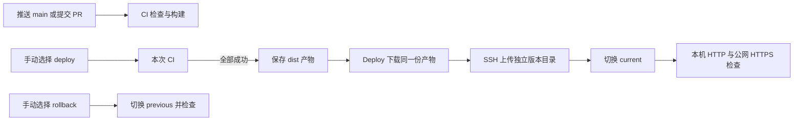

# Douyin CI/CD：从第一次部署到能在面试中讲清楚

这份文档用一个具体例子贯穿全程：修改登录按钮，把代码推到 GitHub，检查通过后手动发布到 `https://dy.sunshinedairy.net`；如果新版本有问题，再恢复上一版。

读完后，你应该能回答三个问题：谁在检查代码，服务器收到的到底是什么，以及失败时网站会停在哪个版本。日常操作速查见 [阿里云部署说明](aliyun-deployment.md)。

## 1. 先把一次发布看完整

CI 是持续集成：每次提交后自动安装依赖、检查、测试和构建，尽早发现问题。CD 在本项目中是持续交付：准备好可以发布的产物，由人决定什么时候上线。我们选择手动触发生产发布。



推送代码的流程到 CI 就结束。点击 `deploy` 时会为选定提交重新跑 CI，然后由 `needs: verify` 把 Deploy 排在成功的 CI 后面。失败或取消不能进入发布分支。`rollback` 不构建当前代码，它恢复服务器已成功发布过的旧版本，所以坏掉的新代码不会阻断回滚。

一份 workflow 是一个流程文件；job 是其中的任务，默认运行在各自的 GitHub 临时机器上。`verify` 和 `deploy` 不共享磁盘，因此需要 artifact：GitHub 保存并交给后续任务下载的构建产物。仓库只保留 `.github/workflows/deploy-aliyun.yml` 这一个入口。

### 怎样读懂“CI 通过才能部署”

完整配置在仓库的 `.github/workflows/deploy-aliyun.yml`。下面只摘录 Deploy 的前置条件，不是独立工作流文件：

```yaml
needs: verify
if: >-
  !cancelled() && github.ref == 'refs/heads/main' && github.event_name == 'workflow_dispatch' &&
  ((inputs.operation == 'rollback' && needs.verify.result == 'skipped') ||
   (inputs.operation != 'rollback' && needs.verify.result == 'success'))
```

`needs` 声明任务依赖；`needs.verify.result` 是 CI 的结果。普通发布要求它等于 `success`，同时要求手动触发且分支为 `main`。回滚要求操作为 `rollback`、CI 确实被跳过。`!cancelled()` 避免已取消的运行继续上线，也让回滚可以明确处理被跳过的依赖。

CI 本身通过 `if: inputs.operation != 'rollback'` 决定是否执行。部署密钥只在 Deploy 引用的 Environment 中提供，不通过 PR 检查任务传递。手动操作在点击时确定提交 SHA，后续任务使用这个提交，不随 `main` 的新推送漂移。

推送和手动发布会分别运行 CI，多花一轮检查时间，换来每次发布记录里都能直接找到对应检查和产物；同一次发布的 Deploy 不重复构建。修复发布环境问题后重跑 Deploy，可以复用那次成功 CI 的产物。

## 2. 浏览器访问时，各部分负责什么

```text
浏览器 → DNS 找到 47.80.28.238 → Caddy 的 HTTPS 443
       → 127.0.0.1:8088 → douyin-web-1 中的 Nginx
       → /srv/douyin/current/index.html、JS、CSS、图片和 Mock 数据
```

Vue 源码不能直接作为生产站点发布。`pnpm build:server` 调用 Vite，生成浏览器可读取的 `dist/`。Node、pnpm 和 Vite 运行在 GitHub；服务器只需要 Docker、Nginx、Python 和 rsync。页面中的远程示例视频仍依赖原媒体地址。

Caddy 负责域名、证书和反向代理；Nginx 负责返回静态文件。`/home`、`/login/password` 是前端路由，Nginx 找不到同名文件时返回 `index.html`，由 Vue Router 决定显示什么。缺失的 JS 和 JSON 必须返回 404，不能把 HTML 冒充脚本。

## 3. 第一次部署：先确认自己在哪台机器操作

下面明确区分三个位置：**本机终端**、**服务器管理员终端**、**GitHub/阿里云网页**。不要在本机执行服务器的创建账号命令。

实际环境是 Ubuntu 24.04、x86_64、已有 Docker 和 Streamlab。此次没有购买服务器，也没有重装系统。全新服务器分支的安装命令提供给学习者参考，未在当前生产机重复执行。

在阿里云控制台先确认实例处于运行状态、公网 IP、区域、磁盘余量和系统版本。用控制台的远程连接或已有管理员 SSH 登录，进行只读检查：

```bash
uname -m
cat /etc/os-release
free -h
df -h /
sudo ss -ltnp
sudo docker ps --format '{{.Names}} {{.Ports}}'
sudo docker compose version
```

已有服务时记录端口和目录。当前 80/443 已归 Streamlab 的 Caddy 使用，新站点采用独立的 8088 回环端口，不能再抢占 80/443。阿里云防火墙需要允许网站的 TCP 80/443，以及管理使用的 SSH 22；不需要向公网开放 8088。

### 3.1 只有全新、未安装 Docker 的服务器才做这一步

以下为 Ubuntu 官方软件源安装方式，来源为 [Docker 安装文档](https://docs.docker.com/engine/install/ubuntu/)。已有 Docker 的当前服务器跳过，不执行卸载或升级。

```bash
sudo apt-get update
sudo apt-get install -y ca-certificates curl python3 rsync
sudo install -m 0755 -d /etc/apt/keyrings
sudo curl -fsSL https://download.docker.com/linux/ubuntu/gpg -o /etc/apt/keyrings/docker.asc
sudo chmod a+r /etc/apt/keyrings/docker.asc
sudo tee /etc/apt/sources.list.d/docker.sources >/dev/null <<EOF_DOCKER
Types: deb
URIs: https://download.docker.com/linux/ubuntu
Suites: $(. /etc/os-release && echo "${UBUNTU_CODENAME:-$VERSION_CODENAME}")
Components: stable
Architectures: $(dpkg --print-architecture)
Signed-By: /etc/apt/keyrings/docker.asc
EOF_DOCKER
sudo apt-get update
sudo apt-get install -y docker-ce docker-ce-cli containerd.io docker-buildx-plugin docker-compose-plugin
sudo systemctl enable --now docker
sudo docker compose version
```

最后应显示 Compose 版本。若主机已经有其他来源的容器运行环境，先按官方兼容说明检查，不能照着教程卸载正在支撑网站的服务。

### 3.2 准备源码和本机工具

本机安装 Git、Node 24、GitHub CLI，并登录自己的 GitHub 账号。仓库已固定 pnpm 11.21.0；沿用锁文件，避免本地和 CI 安装出不同依赖。

```bash
git clone https://github.com/woyaofei303/douyin.git
cd douyin
corepack enable
pnpm --version
pnpm install --frozen-lockfile
pnpm build:server
gh auth login
```

预期生成 `dist/index.html`、`dist/js/` 等文件。当前维护副本在 `/Users/julian/douyin-tailwind`，已存在时直接进入该目录，不必重新克隆。

### 3.3 配置 DNS

阿里云 DNS 控制台打开 `sunshinedairy.net`，添加一条记录：

```text
记录类型：A
主机记录：dy
记录值：47.80.28.238
TTL：10 分钟
```

保留已有 `live` 记录。不要为了部署子域名修改根域名 `@`。本机查询：

```bash
dig +short dy.sunshinedairy.net A
```

预期返回目标服务器 IP；DNS 缓存未刷新时先等待或查询公共解析器，不要反复创建同名记录。DNS 只负责找到机器，站点能否打开还取决于服务和 HTTPS。

### 3.4 创建专用 SSH 密钥和发布账号

SSH 的私钥用于证明“我是被允许的发布方”，主机公钥用于证明“对面确实是这台服务器”，两者用途不同。

本机生成专用密钥；如果同名文件已经存在，检查并复用，不覆盖：

```bash
install -d -m 700 ~/.ssh
test ! -e ~/.ssh/douyin-deploy_ed25519 && \
  ssh-keygen -t ed25519 -N '' -f ~/.ssh/douyin-deploy_ed25519 -C douyin-production
```

将 **`.pub` 公钥文件** 通过已确认的管理员通道传到服务器 `/tmp/douyin-deploy.pub`。私钥保留在本机和 GitHub Secret，不传到服务器、不打印到日志。以下示例中的管理员账号和私钥路径需要换成你已有的实际值：

```bash
scp -i /path/to/admin-key ~/.ssh/douyin-deploy_ed25519.pub admin@47.80.28.238:/tmp/douyin-deploy.pub
```

在服务器管理员终端进入 root shell，再执行一次性初始化：

```bash
sudo -i
```

确认已进入服务器 root shell，再执行：

```bash
set -eu
test ! -e /srv/douyin
if id douyin-deploy >/dev/null 2>&1; then echo "账号已存在，停止初始化"; exit 1; fi
ssh-keygen -lf /tmp/douyin-deploy.pub
useradd --create-home --shell /bin/bash douyin-deploy
install -d -m 755 -o douyin-deploy -g douyin-deploy /srv/douyin /srv/douyin/releases /srv/douyin/shared
install -d -m 700 -o douyin-deploy -g douyin-deploy /home/douyin-deploy/.ssh
{ printf 'restrict '; cat /tmp/douyin-deploy.pub; } > /home/douyin-deploy/.ssh/authorized_keys
chown douyin-deploy:douyin-deploy /home/douyin-deploy/.ssh/authorized_keys
chmod 600 /home/douyin-deploy/.ssh/authorized_keys
```

前两个检查不通过就停止：说明可能已经初始化，不能继续覆盖。该账号不加入 sudo 或 Docker 组；它负责写本项目的静态文件，不负责管理整台机器。`restrict` 关闭端口转发、代理转发和终端分配，并不等于把账号限制成只能执行一条命令。

通过阿里云可信管理员终端读取主机指纹：

```bash
ssh-keygen -lf /etc/ssh/ssh_host_ed25519_key.pub
```

本机采集公钥并对照上面的指纹：

```bash
ssh-keyscan -t ed25519 47.80.28.238 > /tmp/douyin-host-key
ssh-keygen -lf /tmp/douyin-host-key
```

只有两边一致才保存为可信文件：

```bash
install -m 600 /tmp/douyin-host-key ~/.ssh/douyin_known_hosts
```

不要用 `StrictHostKeyChecking=no` 解决指纹不匹配；那会跳过“是不是目标服务器”的校验。

### 3.5 安装 Nginx 容器

本机把仓库中的服务配置上传到管理员临时目录：

```bash
ssh -i /path/to/admin-key admin@47.80.28.238 'mkdir -p /tmp/douyin-config'
scp -i /path/to/admin-key deploy/compose.yml deploy/nginx.conf deploy/Caddyfile admin@47.80.28.238:/tmp/douyin-config/
```

服务器 root 终端：

```bash
install -d -m 755 /srv/douyin/config
install -m 644 /tmp/douyin-config/compose.yml /tmp/douyin-config/nginx.conf /srv/douyin/config/
docker compose -f /srv/douyin/config/compose.yml config --quiet
docker compose -f /srv/douyin/config/compose.yml pull web
docker compose -f /srv/douyin/config/compose.yml up -d web
docker inspect douyin-web-1 --format '{{.State.Status}}'
```

预期是 `running`。此时还没有发布产物，网站返回 404 是可能的；容器启动和业务发布是两件事。配置把 8088 绑定到 `127.0.0.1`，并限制容器最多使用 64MB 内存和 0.5 核 CPU。

### 3.6 接入 Caddy 和 HTTPS：选择符合自己机器的一条分支

**当前机器已有 Streamlab Caddy。** 先确保 Streamlab 管理员入口已经支持 `shared/extra-sites.caddy`，其升级方法见另一项目的部署说明；仅修改当前 Caddyfile 不够，下一次 Streamlab 发布可能将其重写。

服务器 root 终端，先备份，再追加本站片段。已有 `dy` 配置时跳过这段首次接入命令，检查现状：

```bash
set -eu
task_backup="/root/douyin-proxy-backup-$(date +%Y%m%d-%H%M%S)"
mkdir -m 700 "$task_backup"
task_config=/home/admin/streamlab/shared/config/Caddyfile
task_extra=/home/admin/streamlab/shared/extra-sites.caddy
if grep -qF 'dy.sunshinedairy.net' "$task_config"; then echo '站点已配置，停止重复追加'; exit 1; fi
if test -f "$task_extra" && grep -qF 'dy.sunshinedairy.net' "$task_extra"; then echo '额外站点已配置，先检查现状'; exit 1; fi
cp -p "$task_config" "$task_backup/Caddyfile"
if test -f "$task_extra"; then cp -p "$task_extra" "$task_backup/extra-sites.caddy"; fi
{ cat "$task_config"; printf '\n'; cat /tmp/douyin-config/Caddyfile; } > "$task_backup/candidate"
docker cp "$task_backup/candidate" streamlab-proxy-1:/tmp/douyin-candidate
docker exec streamlab-proxy-1 caddy validate --config /tmp/douyin-candidate --adapter caddyfile
cat "$task_backup/candidate" > "$task_config"
if docker exec streamlab-proxy-1 caddy reload --config /etc/caddy/Caddyfile --adapter caddyfile; then
  if test -s "$task_extra"; then printf '\n' >> "$task_extra"; fi
  cat /tmp/douyin-config/Caddyfile >> "$task_extra"
  chmod 644 "$task_extra"
else
  cat "$task_backup/Caddyfile" > "$task_config"
  docker exec streamlab-proxy-1 caddy reload --config /etc/caddy/Caddyfile --adapter caddyfile
  exit 1
fi
```

配置文件通过原路径写入，保留容器绑定的文件；候选配置先验证再热加载。原始配置备份可以恢复。证书由 Caddy 自动申请，需要 DNS 已指向当前机器、80/443 可达。

**全新机器没有任何反向代理。** 不执行上一段，复制本站的 `deploy/Caddyfile` 到 `/srv/douyin/config/Caddyfile`，创建 `/srv/douyin/config/caddy.compose.yml`：

```yaml
name: douyin-proxy
services:
  proxy:
    image: caddy:2-alpine
    network_mode: host
    restart: unless-stopped
    volumes:
      - ./Caddyfile:/etc/caddy/Caddyfile:ro
      - caddy_data:/data
      - caddy_config:/config
volumes:
  caddy_data:
  caddy_config:
```

确认 80/443 没有其他服务占用后启动：

```bash
install -m 644 /tmp/douyin-config/Caddyfile /srv/douyin/config/Caddyfile
docker compose -f /srv/douyin/config/caddy.compose.yml up -d
```

这条独立代理分支是新服务器安装参考，本次实际使用的是共享 Streamlab 代理分支。

### 3.7 配置 GitHub Environment

网页打开仓库 Settings → Environments，新建 `aliyun-production`，把允许部署的分支限定为 `main`。Environment 是生产环境配置边界，部署任务通过 `environment` 引用它，普通 PR 的检查任务拿不到这里的 SSH 密钥。

在本机终端写入变量与密钥，私钥通过标准输入传给 GitHub，不在终端显示：

```bash
gh variable set ALIYUN_HOST --repo woyaofei303/douyin --env aliyun-production --body '47.80.28.238'
gh variable set ALIYUN_USER --repo woyaofei303/douyin --env aliyun-production --body 'douyin-deploy'
gh variable set ALIYUN_PORT --repo woyaofei303/douyin --env aliyun-production --body '22'
gh secret set ALIYUN_SSH_PRIVATE_KEY --repo woyaofei303/douyin --env aliyun-production < ~/.ssh/douyin-deploy_ed25519
gh secret set ALIYUN_SSH_KNOWN_HOSTS --repo woyaofei303/douyin --env aliyun-production < ~/.ssh/douyin_known_hosts
```

Environment 建立和分支限制参考 [GitHub 环境说明](https://docs.github.com/en/actions/how-tos/deploy/configure-and-manage-deployments/manage-environments)，密钥录入参考 [GitHub Secrets](https://docs.github.com/en/actions/how-tos/write-workflows/choose-what-workflows-do/use-secrets)。

### 3.8 第一次真正发布

打开 Actions → CI & Production → Run workflow，分支选 `main`，操作选 `deploy`。或者本机执行：

```bash
gh workflow run deploy-aliyun.yml --repo woyaofei303/douyin --ref main -f operation=deploy
gh run list --repo woyaofei303/douyin --workflow deploy-aliyun.yml --limit 5
```

CI 包含 ESLint、6 个部署测试、15 个 Chromium 交互测试和服务器构建。**完整 TypeScript 检查仍有历史错误，尚未作为该项目的 CI 门槛；不能把 CI 绿灯说成所有类型检查通过。**

CI 成功后上传本次 `dist`，Deploy 下载这份产物，确认 `version.txt` 与提交匹配。第一次 rsync 没有旧文件可复用，以后相同文件使用硬链接减少磁盘占用；修改文件会独立写入，不原地覆盖旧版本。

部署完成后，本机验证：

```bash
curl --fail https://dy.sunshinedairy.net/version.txt
curl --head http://dy.sunshinedairy.net/home
curl --head https://dy.sunshinedairy.net/login/password
```

预期版本标识为 `40位提交号-运行号-重试号`，HTTP 跳转 HTTPS，深层路由返回 200。浏览器再实际打开登录、首页和设置页面。HTTP 200 只证明服务器返回内容，不能代替页面渲染或交互检查。

## 4. current、previous 和共享资源怎样协作

```text
/srv/douyin/
  releases/<版本 A>/
  releases/<版本 B>/
  current  → releases/<版本 B>/
  previous → releases/<版本 A>/
  shared/js/、shared/assets/
  config/
```

可以把版本目录理解为已打包的两套页面，`current` 是当前开放的入口。上传 B 时仍对外提供 A；上传完成后，用原子替换把入口一次切到 B。脚本持有文件锁，避免两个操作同时改入口。

`deploy/release.py` 会检查版本目录、标识和链接是否仍位于本项目目录内。切换后请求回环地址的 `version.txt`；失败就恢复 A，通过才记录 `previous=A`。最后 GitHub 检查公网 HTTPS。公网检查失败会让工作流失败，但不会自动回退已经通过本机检查的版本，需要运维根据原因决定是否手动回滚。

已经打开 A 的用户可能继续请求 A 的延迟加载脚本，所以旧哈希 JS/CSS 保留在 `shared`。不能切换入口后立刻删除旧资源。当前版本目录和共享资源没有自动清理策略，磁盘使用需要人工关注。

## 5. 回滚演练与失败处理

第一次成功发布没有上一版本。至少成功发布两次，再选择 `rollback`，或执行：

```bash
gh workflow run deploy-aliyun.yml --repo woyaofei303/douyin --ref main -f operation=rollback
```

预期 CI 被跳过、Rollback 成功，公网 `version.txt` 变成原 `previous`。回滚也做本机检查；失败会恢复回滚前版本。回滚后旧 `current` 成为 `previous`，再次回滚会切回另一版。Git 提交和用户浏览器数据不会因此撤销。

需要恢复新版本时重新选择 `deploy`。如果只是重试已经通过 CI 的 Deploy，可以在同一运行中重跑该任务，复用原产物；产物保留 7 天，过期后重新运行整个流程。

常见故障按出现位置排查：

- CI 红灯：看第一个失败步骤，服务器不会开始部署；不要跳过测试强行发布。
- SSH 认证失败：核对 Environment、账号、公钥及文件权限；主机指纹变化先通过可信控制台核实。
- 页面 404：检查 `/srv/douyin/current` 是否存在，以及深层路由是否进入 Nginx 的 HTML 回退规则。
- HTTPS 失败：检查 DNS、80/443、Caddy 日志；不要误改原有 `live` 记录。
- 工作流显示 pending：同仓库的 `main` 流程正在执行，发布与回滚会排队；不要取消正在切换的操作。
- Streamlab 更新后 `dy` 不通：检查管理员额外站点文件及已安装的 Streamlab 发布入口版本。

## 6. 面试时怎样讲，而不是只背工具名

可以按下面的顺序用约一分钟讲述，再根据追问展开：

> 我给一个 Vue/Vite 静态应用建立了 GitHub Actions 交付流程。推送只做 CI，生产通过同一个工作流手动选择发布。CI 检查、浏览器交互测试和构建全部成功后，部署任务下载这次生成的产物，不在服务器重新构建。服务器用专用普通账号接收文件，Nginx 提供静态站点，Caddy 负责 HTTPS。每次发布写入独立目录，通过原子切换软链接上线，并验证实际版本；本机检查失败会恢复原版本。旧哈希资源保留，避免旧页面懒加载失败。同一入口也能回滚上一成功版本。

遇到这些追问，要解释取舍：

- **为什么手动部署？** 推送不应立即改变演示环境，由操作人选择发布时间；检查过程仍然自动化。
- **为什么构建一次？** 让测试通过的那份文件就是上线的文件，减少两次构建环境或依赖差异。
- **为什么不能直接覆盖 dist？** 覆盖过程中可能出现新 HTML 配旧 JS；独立目录上传后一次切换降低这种风险。
- **为什么要主机指纹？** 私钥证明客户端身份；指纹校验防止连到错误服务器。
- **能保证零停机吗？** 静态文件切换很短，但这仍是单机方案；共享代理重建、主机故障和外部媒体故障都不是软链接回滚能解决的。
- **CI 通过就绝对安全吗？** 它只证明已配置的检查通过。本项目仍有历史类型诊断，真机兼容性、外部媒体和容量也需要单独验证。

对应源码：工作流在 `.github/workflows/deploy-aliyun.yml`，构建入口在 `package.json` 和 `vite.config.ts`，服务配置在 `deploy/compose.yml`、`deploy/nginx.conf`、`deploy/Caddyfile`，版本切换与回滚在 `deploy/release.py`，故障测试在 `deploy/test_release.py`。

## 7. 本次实际验证与边界

2026-10-20 的实际记录：

- [手动 CI → Deploy 成功](https://github.com/woyaofei303/douyin/actions/runs/39393947295)，线上应用提交为 `efebb6f1b5c10aa33ac6dd5fa1e16515972c88a3`。
- [工作流回滚成功](https://github.com/woyaofei303/douyin/actions/runs/39392426716)，CI 被跳过；随后成功用已验证产物恢复新版本。
- 推送 CI 成功，Deploy 被跳过；Actions 只保留一个有效工作流。
- 6 个部署测试和 15 个 Chromium 交互用例通过，工作流通过 actionlint 检查。
- 线上首页、密码登录和设置页在 390×844 视口检查通过，无页面脚本异常、无站内 HTTP 错误；采样时首页视频实际播放。
- HTTPS 版本匹配，HTTP 返回 308 跳转，缺失 JS/JSON 返回 404；Streamlab 发布、回滚和恢复期间再次检查 `dy` 仍可访问。
- Streamlab 额外站点配置及入口脚本已在服务器备份、升级，入口升级未重启容器。

完整手机设备模拟曾触发页面反复导航，尚未完成该模式和真机的全面回归；上述线上浏览器结果使用 Android User-Agent、触摸能力及固定视口，不等同于真实手机验收。历史类型错误未在本次处理。空白服务器的 Docker 安装和独立 Caddy 分支是安装参考，本次实际复用了已有服务。

学习时可以复述这些已验证事实；不要把 CI 中的模拟浏览器说成真实手机验收，也不要把未在空白服务器重新执行的安装参考说成已经完整演练。
