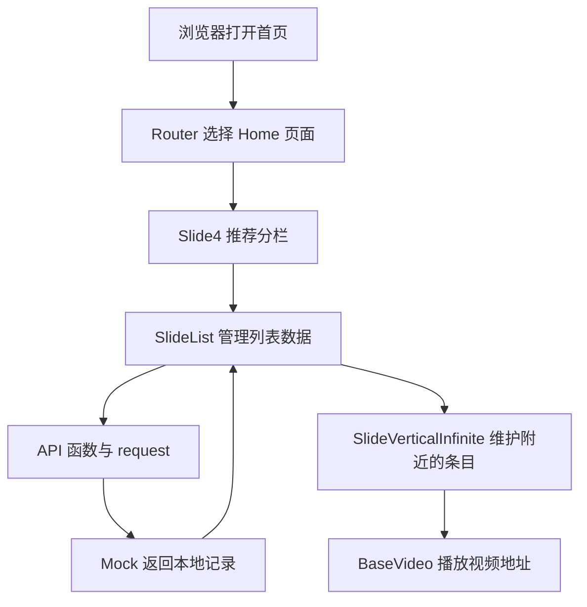

# 01 项目地图：先知道自己在读什么

你打开的是一个模仿抖音界面的 Vue 单页应用。单页应用的意思是：浏览器先加载一个 HTML 入口，之后主要由 JavaScript 替换当前显示的组件，不是每点一个菜单就下载一张全新的 HTML 页面。

项目最值得学习的是组件协作、移动端交互和数据流。它没有提供一套完整的短视频后端：用户资料、视频列表等主要来自仓库数据，很多操作只改变浏览器内存。

## 跟着一次“看推荐视频”认识各层

浏览器打开 `/`，路由将它转到 `/home`。首页选择推荐分栏，分栏把“请求推荐视频”的函数交给列表。列表调用这个函数，Mock 拦截请求，返回本地视频数据。列表把每条记录交给播放器，播放器才去加载记录中的视频地址。



这里的“数据在本地”指列表记录在本地，不代表所有视频文件也在本地。`BaseVideo.vue` 会使用 `item.video.play_addr.url_list` 中的地址，网络资源失效仍可能导致某条视频不能播放。

## 技术各自解决什么问题

以下是分析时读取 `node_modules` 得到的本地版本；换一台机器重新安装时，应再核对锁文件和安装结果。

- Vue `3.5.13`：把状态转换成页面，状态改变时更新界面。
- Vue Router `4.3.0`：决定 URL 对应哪个页面。
- Pinia `2.3.0`：让不同组件共享用户资料、加载状态等数据。
- Vite `6.4.2`：提供开发服务器，并把源码构建成浏览器可加载的文件。
- TypeScript `5.3.3`：检查部分类型；项目也有普通 JavaScript，且 `strict` 没有开启。
- Axios 与 `axios-mock-adapter`：前者组织请求，后者在浏览器中模拟接口响应。
- Tailwind CSS `4.3.3`：在模板中用原子类表达布局、间距、颜色和状态；主题变量、基础规则与共享动画集中在 `src/assets/styles/`。
- Vue Macros `2.13.5`：支持项目使用的部分编译期语法，例如 `$ref`。

当前项目使用 Vite 6 和 Tailwind CSS v4。样式迁移已经完成，不再使用 Less；尺寸约定与动态样式例外见 [Tailwind 样式约定与回归](../tailwind-migration.md)。

## 文件放在哪里

```text
index.html                  浏览器入口，包含 #app 容器
vite.config.ts              开发端口、别名、插件、构建配置
env/                        不同构建模式使用的环境配置
src/main.ts                 创建 Vue 应用并安装插件
src/App.vue                 页面容器、动画、缓存与初始化
src/router/                 URL 与页面的映射、导航守卫
src/pages/                  首页、个人页、商城、消息、登录等页面
src/components/             多个页面共用的组件
src/components/slide/       滑动容器、播放器、视频工具栏
src/store/pinia.ts          共享状态 useBaseStore
src/api/                    按业务命名的接口函数
src/mock/index.ts           模拟接口以及本地数据组装
src/utils/                  请求、事件总线、DOM、手势等辅助逻辑
src/assets/                 随源码引用的图片、样式、少量初始数据
public/data/                通过 URL 读取的静态数据
node/                       数据整理脚本，不是运行网页所需的后端
docs/learning/              本套学习文档
```

`src/assets` 和 `public` 的区别可以用视频数据说明：`posts6.json` 被源码直接 `import`；`public/data/videos.json` 则经 `fetch('/data/videos.json')` 读取。后者的 URL 不带 `public`。

源码入口：[main.ts](../../src/main.ts)、[App.vue](../../src/App.vue)、[routes.ts](../../src/router/routes.ts)、[vite.config.ts](../../vite.config.ts)。

## 页面地图，不等于功能完成清单

- 首页 `/home`：推荐视频、横向分栏、评论、作者面板。重点入口是 [home/index.vue](../../src/pages/home/index.vue)。
- 商城 `/shop`：商品列表与详情，数据接口在 [api/user.ts](../../src/api/user.ts)，Mock 从 `goods.json` 取数据。
- 个人页 `/me`：资料、作品、收藏及设置入口。先学习 [EditUserInfo.vue](../../src/pages/me/userinfo/EditUserInfo.vue) 与昵称编辑。
- 消息 `/message`：消息页面和聊天展示。[Chat.vue](../../src/pages/message/chat/Chat.vue) 的消息主要定义在组件本地数组中。
- 登录 `/login`：输入框、协议选择、按钮状态。[PasswordLogin.vue](../../src/pages/login/PasswordLogin.vue) 的 `login()` 在检查协议后设置加载状态，没有完成真实鉴权请求。
- 发布 `/publish`、直播 `/home/live` 等：有对应路由，但不能仅凭页面存在就推断已接入上传、推流或交易系统。

遇到按钮调用 `_no()`，它实际只是提示“未实现”，定义在 [utils/index.tsx](../../src/utils/index.tsx)。先识别这一点，可以少花很多时间追查不存在的业务。

## 第一次阅读先放过哪些内容

先不研究 `node/` 的素材处理、GitHub Actions 部署、压缩数据兼容分支、手势算法的每条公式。它们不是理解一个 Vue 组件的前提。

先回答一个问题：`Slide4` 为什么很短，却能显示整个推荐视频流？答案在于它负责选择接口和传参，真正的列表管理、滑动与播放由下层组件完成。

下一篇：[02 启动与入口](02-running-and-entry.md)。
