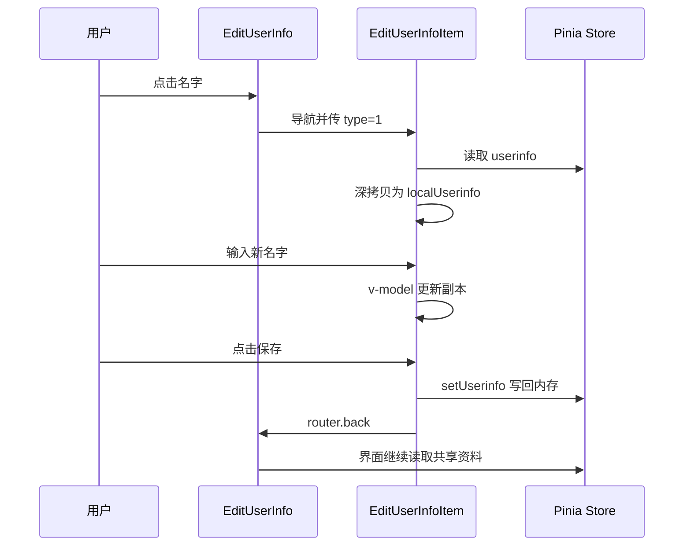

# 04 路由、共享状态与页面缓存

这一篇用“修改昵称再返回”串起三个问题：页面怎样切换，多个页面怎样看到同一份资料，离开页面后哪些东西还在。

## 路由只是 URL 与页面组件的映射

[routes.ts](../../src/router/routes.ts) 把 `/me` 映射到 `Me.vue`，把 `/me/edit-userinfo` 映射到 `EditUserInfo.vue`，把 `/me/edit-userinfo-item` 映射到 `EditUserInfoItem.vue`。

路径虽然含有多层斜杠，这里的路由记录主要仍是平铺的数组，不代表它们一定使用了 Vue Router 的 `children` 嵌套路由。

实际导航函数是 [useNav.ts](../../src/utils/hooks/useNav.ts)。它返回一个函数，内部调用 `router.push({ path, query })`。例如名字入口：

```ts
nav('/me/edit-userinfo-item', { type: 1 })
```

预期 URL 中带上 `?type=1`，编辑页用 `Number(route.query.type)` 取出数字，决定显示“修改名字”。这里的 `type` 是业务参数，不是 TypeScript 类型。

`useNav` 还可接收第三个参数，把对象深拷贝到 `store.routeData`。这份对象没有进入 URL，也没有被此函数写入持久化存储，刷新后不能指望自动恢复。

## Pinia：让页面共享同一份状态

[store/pinia.ts](../../src/store/pinia.ts) 定义 `useBaseStore`。组件调用它，拿到安装在应用中的共享 Store，而不是各自重新创建一份互不相关的用户资料。

这个 Store 包含：

- `state`：实际保存的数据，例如 `userinfo`、`users`、`loading`、`excludeNames`。
- `getters`：从状态计算出的结果，例如 `selectFriends` 筛出已选好友。
- `actions`：操作状态的函数，例如 `init()`、`setUserinfo()`。

`App.vue` 挂载后调用 `init()`。它先请求 `panel()` 更新当前用户资料，再请求 `friends()` 更新 `users`。Mock 的 `panel` 使用固定用户记录，所以初始资料并不来自刚刚完成的一次真实登录。

注意 `friends` 和 `users` 是两个字段：`friends` 初始来自 `resource.users`，而 `users` 由接口初始化。不要因为名字相近就把它们当作同一份数组。

## 沿一次昵称修改追踪状态



对应源码是 [EditUserInfo.vue](../../src/pages/me/userinfo/EditUserInfo.vue) 和 [EditUserInfoItem.vue](../../src/pages/me/userinfo/EditUserInfoItem.vue)。请按以下顺序定位：

1. `onMounted`：将 `store.userinfo` 深拷贝到 `data.localUserinfo`。
2. 输入框 `v-model`：只修改这份本地副本。
3. `isChanged`：比较部分字段，判断是否可以保存。
4. `save()`：检查后调用 `store.setUserinfo(data.localUserinfo)`。
5. `_sleep(500)`：模拟等待，随后关闭加载提示并返回。

“副本”很关键：输入到一半还没保存时，不会因为输入框直接绑定全局昵称而立刻影响其他页面。点击返回时，代码检查 `isChanged`，有变化会弹出是否保存的提示。

这里没有真正发出“更新昵称”网络请求。写 Store 发生在等待之前，也没有请求失败回滚流程。直接返回而不保存时，Store 仍保留旧值；点击保存后则写入新值。刷新整页会重建内存，并通过 `init()` 再读初始资料。

这个例子只讲昵称分支。当前代码中的 `signature`、`desc` 比较存在不一致，不能据此承诺简介编辑同样正常，见第 07 篇。

## 四种数据位置不要混淆

- 页面局部状态：例如 `localUserinfo`，属于当前组件。
- Pinia 共享状态：例如 `store.userinfo`，在当前应用内存里供多处使用。
- `localStorage`：浏览器持久化存储，必须显式读写；仓库部分学校选择页面用到了它。
- 后端或静态文件：本项目的大部分初始业务记录在 `public/data`，改 Pinia 不会改这些文件。

因此，“另一个页面也变了”说明它们共享状态，不说明数据已经写入服务器或磁盘。

## 页面离开后，为什么还记得位置

[App.vue](../../src/App.vue) 将路由组件放进 `keep-alive`。它会保留组件实例，便于返回时继续使用已有状态。`exclude="store.excludeNames"` 指定不应被缓存的组件名称。

[router/index.ts](../../src/router/index.ts) 在导航守卫中比较两个路径在路由数组里的位置，决定向 `excludeNames` 添加或移除组件名。`App.vue` 也用类似顺序选择 `go` / `back` 动画。

这是项目自己的“前进/后退”约定，不是浏览器历史方向的通用判断。随意调整路由数组顺序可能改变缓存或动画；组件名也会影响排除缓存的范围。昵称编辑页和资料页当前都声明了 `EditUserInfo` 名称，阅读时要注意它们不是独立唯一的缓存名称。

首页因此区分：

- `onActivated`：重新显示，更新活跃状态并通知视频切换播放状态。
- `onDeactivated`：被缓存但不显示，更新活跃状态并通知播放器。
- `onUnmounted`：真的销毁，做清理。

不要只在 `onMounted` 里写所有“每次返回页面都要做”的逻辑，因为缓存页面再次出现时不会重新挂载。

## 两种 URL 模式

路由配置根据 `IS_SUB_DOMAIN` 选择模式：GitHub Pages / Gitee Pages 对应的环境标记使用 hash 模式，其他模式使用 history 模式。判断来自 [config/index.ts](../../src/config/index.ts)，不是实时检查域名。

hash 模式的页面路径在 `#` 后；history 模式看起来像普通路径。部署 history 模式时，刷新深层路径通常需要静态服务器回退到入口 HTML。本次未验证部署配置，先在本地开发服务器理解路由即可。

下一篇：[05 接口与本地数据](05-api-and-data.md)。
